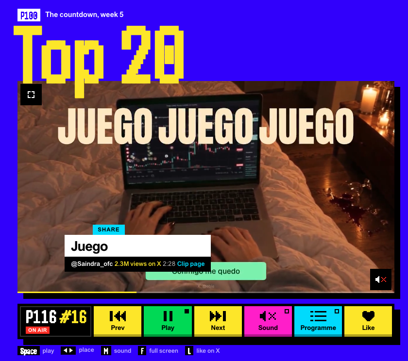
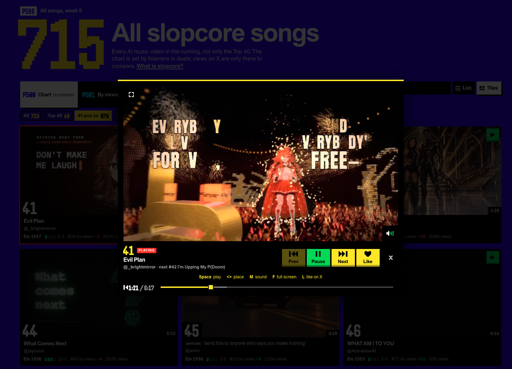

# Better SlopHits

- **Like from duels:** Like buttons beside **A slaps** and **B slaps** let you like either clip on X without casting a vote. They match the voting buttons’ height and stay aligned when you skip to the next pair.
- **Larger songs player:** a responsive lightbox with a dimmed backdrop and controls below the video.
- **Clip-page video quality:** plays the same video source as each song’s dedicated clip page.
- **Like on X:** like tracks from the chart, lightbox, or either side of a duel, with confirmation and protection against unliking an already-liked track.
- **Keyboard controls:** Space to play/pause, < / > to change songs, M for sound, F for fullscreen, and L to like.

Install `better-slop-hits.user.js` in Tampermonkey on regular Google Chrome, using the user's existing profile. Chrome Beta is not the target browser. It runs on SlopHits so that navigation into `/songs` works without a reload.

The songs player opens as a centered lightbox with a dimmed backdrop. Its video is 776 × 436.5 pixels on a sufficiently large desktop viewport, matching the reference clip page, and shrinks to fit smaller screens. Song details, transport buttons, and the seek bar appear below the video. The existing player and playback controls remain in use.

Close with the existing × button, Escape, or a click outside the panel. Closing uses SlopHits' own close action to stop playback. Keyboard focus stays inside the open player and returns to the opener on close; background scrolling is locked while open. Escape in native fullscreen remains the browser's fullscreen exit action.

## Like tracks on X

On the chart, click **Like** after Programme or press **L**. The shortcut is listed after F, and ignores text fields, modifier combinations, composition, and held-key repeats. In the songs lightbox, **Like** follows Next. Buttons and toasts use the site's colors and typography.

On the duel page, each **Like** button sits beside its **A slaps** or **B slaps** button and likes that clip on X without casting a duel vote. Duel likes match the displayed thumbnail to a unique post in SlopHits' public song catalogue; missing or ambiguous matches show an error without opening X. Each click keeps its original track even if the pair changes while the request is pending.

Sign into X in the same regular Chrome profile. Each action opens a temporary background X post tab, clicks the post's native Like button, then reloads to confirm the saved state before showing success. Already-liked posts are left liked. The helper closes when the request finishes. Errors and missing login show an error toast instead of claiming success. If the request times out after X received the click, the like may still have succeeded; retrying checks the existing state rather than toggling it off.

The script also runs on X post pages and uses Tampermonkey's `GM_openInTab` and value-storage/listener grants to communicate with its helper tab. It does not copy cookies, access tokens, or account credentials. Only a short-lived post ID/request token and result are exchanged; the request is deleted afterward. X automation only runs for a valid request created by a SlopHits Like action. It depends on X's page structure and may need maintenance if that changes.

Versions use `YYYY-MM-DD.NN` (Europe/Vienna date and a two-digit daily release number). Current release: `2026-11-02.03`.

Release `2026-11-02.03`: restores each Like button's position when SlopHits replaces the voting buttons after skipping a pair. All 22 Like smoke checks passed against the installed script in background regular Chrome, including real Skip transitions at desktop and mobile widths. Syntax and whitespace checks passed.

Release `2026-11-02.02`: adds Like beside both duel voting buttons, matching their height and bottom shadow. All 21 Like smoke checks passed against the installed script in background regular Chrome, using intercepted X fixtures. Duel coverage includes both post targets, no voting, track changes, unknown-track errors, and equal-height placement at 1440, 390, and 320px. Syntax and whitespace checks passed. Native fullscreen was not exercised.

## Smoke tests

Run `npm ci`, then `npm run check` and `npm run test:smoke` on macOS. Install the current userscript in regular Chrome first. Enable remote debugging at `chrome://inspect/#remote-debugging` and approve the initial connection prompt.

The runner attaches to regular Chrome using its `DevToolsActivePort` file. It tests the installed Tampermonkey script on the live website, without injecting the local source or launching another browser. It opens a temporary background tab, uses page-only viewport emulation, and closes that tab afterward. The shared browser window is not resized or activated. When another app was in front at startup, the suite checks after each enabled test that Chrome has not taken foreground focus, using a read-only macOS AppKit query. Tests play audio/video and require the website and media sources to be available.

Native fullscreen is explicitly skipped in the default background run because it requires foreground interaction. Only when you are ready for Chrome to take focus, opt in with `npm run test:smoke -- --foreground` (or restart the runner with that option). Do not enable this mode while the user is working in another app.

Keep the runner open: press Enter to rerun through the same connection, or `q` to disconnect. A new runner process requires another Chrome approval. `npm run test:smoke:once` runs once and disconnects.

Assertions live in `tests/player-smoke.cjs` and `tests/likes-smoke.cjs`; connection management lives in `scripts/smoke-session.cjs`. Results and desktop/mobile screenshots are written to `.artifacts/smoke/` and `.artifacts/likes/` (excluded from Git). Failures are reported in `results.json` and result in a nonzero exit status. Install local source changes in Tampermonkey before rerunning.

The Like suite uses the installed userscript on SlopHits with locally intercepted X post fixtures. It tests confirmation after reload, already-liked posts, failed persistence, logged-out state, duplicate keys, ignored shortcuts, intro playback, track changes, cancellation, helper cleanup, and responsive button placement. New helper navigations to non-fixture X posts are blocked during this suite, so it never likes real posts. A real end-to-end check requires a separately authorized post and is not part of the automated suite.

Live verification for `2026-11-01.02`: the user-authorized Bliss post (`2106157622986748377`) was liked through the songs button and independently confirmed liked after reloading X. The like was left in place.

Release `2026-11-01.02` validation: 13 player checks and 15 Like checks passed in regular Chrome; native fullscreen was skipped in background mode. Syntax and whitespace checks passed. Desktop and mobile screenshots are saved with the local test results.

The 2026-11-01.01 release passed all 14 checks in regular Chrome 156: installed-script startup, video sizing/control layout, pause/resume, next/previous, sound/seek, keyboard focus, native fullscreen, Escape/focus restoration, backdrop/close/reopen, portrait and landscape layout, list view, SPA navigation, and uncaught page errors. The smoke test exposed and verified a fix for focus restoration after pointer activation.

Release `2026-11-01.03` fixes premature rejection of a stale Like button during X hydration after reload. Confirmation waits for the saved Unlike state, ignores brief login UI, and reports an uncertain timeout without incorrectly requesting login. Regression verification: 13 player checks and 16 Like checks passed in background regular Chrome; native fullscreen skipped. A real Like on rank 42, “I’m Upping My P(Doom)” (`2102801274173587569`), returned FavoriteTweet success and a success toast after fresh-page confirmation. Rank 41 “Evil Plan” was also liked during investigation; both remain liked. The originally reported intermittent live failure did not recur; delayed-state and transient-login cases are covered by browser fixtures.

Release `2026-11-01.04`: the songs lightbox reads each track’s clip page and uses its exact video source, instead of enlarging the native low-resolution dock source. For Evil Plan this upgrades 640×360 to 1280×720. Sources are cached during the page session; track changes discard stale responses. Playback position and play/pause state are restored when switching sources. If the clip page or upgraded video cannot load, native playback remains available.

Release `.04` verification: 14 player checks and 16 Like checks passed in regular Chrome background tabs, including exact clip-source equality and decoded 1280×720 dimensions, source matching after next/previous, and existing playback controls. Native fullscreen remains skipped to avoid stealing focus. Syntax and whitespace checks passed.

Release `2026-11-01.05`: the open songs lightbox supports Space (play/pause), < / > or left/right arrows (previous/next place), M (sound), F (fullscreen), and L (Like on X). The shortcut legend appears between the player buttons and progress bar and wraps on narrow screens. Shortcuts ignore typing fields, modifiers, composition and held-key repeats; a focused progress slider retains native arrow-key seeking.

Release `2026-11-01.06` verification: all 33 enabled smoke checks passed (17 player, 16 Like) against the installed script in background regular Chrome. Native fullscreen was skipped to avoid stealing focus; F dispatch to its control was verified. Syntax and whitespace checks passed. The suites assert no uncaught JavaScript errors (`pageerror`); they do not assert a clean console or collect `console.error()` messages, warnings, or failed network requests.

Release `2026-11-01.07`: hide the songs lightbox keyboard legend at mobile widths (600px and below), including its grid row. Desktop keeps the legend. Verified with Playwright in a background regular Chrome tab using the local stylesheet on the live songs page: hidden at 390/600px, visible at 601/844/1440px. Syntax and whitespace checks passed. This targeted check did not update the installed Tampermonkey script or exercise native fullscreen.

Release `2026-11-01.08`: remove the songs lightbox keyboard legend entirely on desktop and mobile, including its creation code, styles, and grid row. Keyboard controls remain available. Installed in regular Chrome and confirmed the saved source matches the local file. All 17 enabled player smoke checks passed against the installed script, including absent legends at desktop, mobile portrait, and landscape widths; native fullscreen was skipped in background mode. Syntax and whitespace checks passed. The iPhone installation is not accessible from this workspace.
